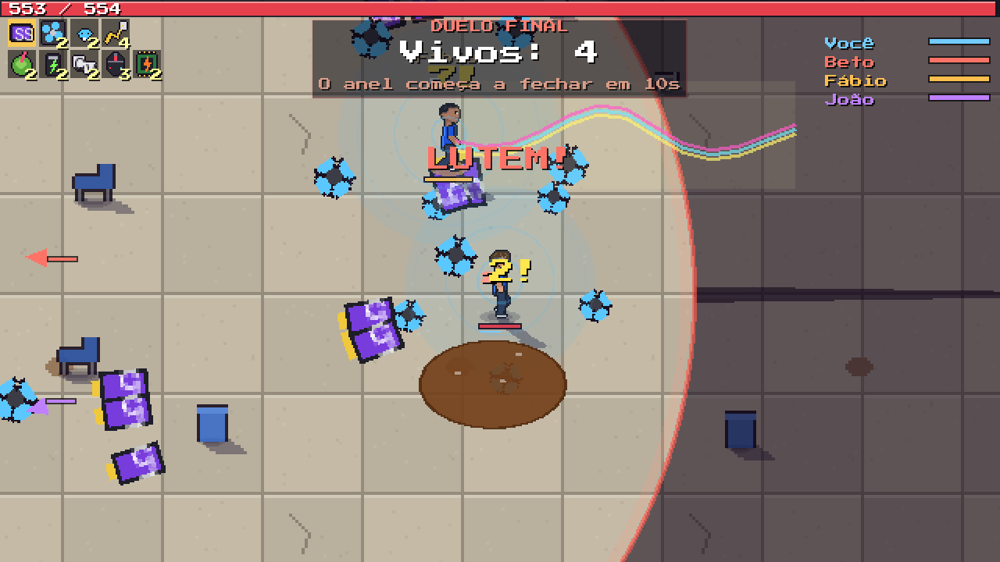
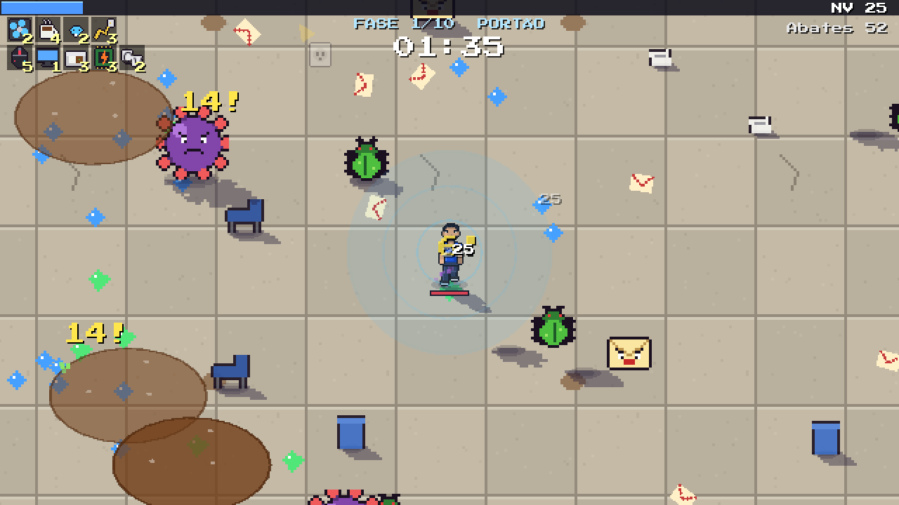
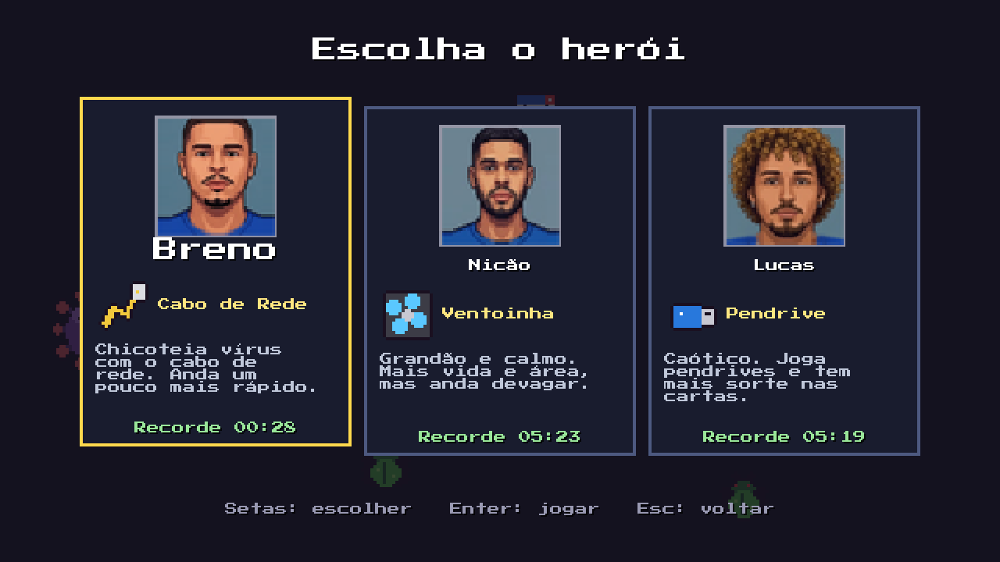
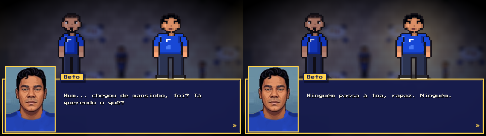
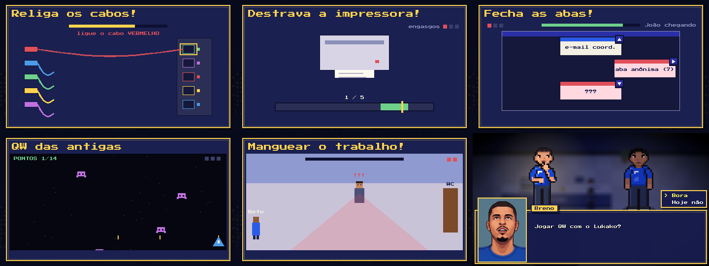

<div align="center">

# 🎮 KIKIU-Survival

**Uma engine em Godot para contar histórias em pixel art, e os jogos feitos com ela.**

[](https://godotengine.org/download/archive/4.4.1-stable/)
[](#-estrutura-do-repositório)
[](docs/VISUAL_KIKIU.md)
[](docs/ONLINE_KIKIU.md)
[](#-gerar-o-executável-exe)
[](LOGBOOK.md)



</div>

---

## 📑 Sumário

- [🎮 Os jogos](#-os-jogos)
  - [⚔️ K.I.K.I.U](#️-kikiu--knights-in-kaos-infinite-upgrades)
  - [🎓 JOGO da Cairu](#-jogo-da-cairu)
- [🎨 Direção de arte](#-direção-de-arte)
- [🚀 Como rodar](#-como-rodar)
- [📦 Gerar o executável (.exe)](#-gerar-o-executável-exe)
- [📂 Estrutura do repositório](#-estrutura-do-repositório)
- [📚 Documentação](#-documentação)
- [🤝 Como colaborar](#-como-colaborar)
- [👥 Equipe](#-equipe)

---

## 🎮 Os jogos

### ⚔️ K.I.K.I.U — *Knights In Kaos, Infinite Upgrades*

> Sobreviva à horda com seus amigos e vença o **duelo final** entre vocês.

Um *survivors-like* (pegada de **Vampire Survivors**, com toques de **Risk of Rain 2** e **Megabonk**) com uma corrida de 10 fases e um final em que os jogadores se enfrentam.

| | |
|:---:|:---:|
|  |  |
| **A horda:** armas automáticas, XP e cartas | **Heróis** com arma e atributos próprios |

- 🗡️ **Armas automáticas e evoluções:** arma no nível máximo + o passivo certo + um baú = evolução.
- 📈 **Diretor de dificuldade** (estilo Risk of Rain 2): a pressão cresce com o tempo, com chefes, cercos e enxames.
- 🧭 **Corrida de 10 fases**, com chefe no fim de cada uma e baú entre elas.
- 🏟️ **Duelo final:** todos contra todos numa arena redonda que vai fechando, com equilíbrio de builds.
- 🌐 **Online até 6 pessoas**, sem servidor pago: quem cria a sala hospeda (túnel grátis do playit.gg).
- 🤝 **Reviver:** quem cai vira corpo; um amigo perto segurando o botão levanta (o Nicão levanta mais rápido).
- 🌑 **Profundidade em pixel art:** sombras projetadas com uma luz só, calculadas pixel a pixel.

📖 Regras e controles em [`jogos/hordas/LEIA-ME.txt`](jogos/hordas/LEIA-ME.txt) · desenho do jogo em [`docs/DESENHO_DO_JOGO_HORDAS.md`](docs/DESENHO_DO_JOGO_HORDAS.md)

### 🎓 JOGO da Cairu

> Histórias engraçadas e verdadeiras do Breno na Faculdade Cairu, em Salvador.

<p align="center">
  
</p>

- 💬 **Cenas e diálogos com rosto e voz**, escritos numa sintaxe curta em `.txt` (dá pra escrever história sem programar).
- 🕹️ **Minijogos** dentro das histórias: religar cabos, destravar impressora, QW das antigas e mais.
- ✅ **Validador de história** e modo de teste (F5/F6) pra conferir as cenas antes de jogar.
- 🌐 **Online até 6 pessoas**, vendo as cenas juntos.
- ♻️ **Engine separada do conteúdo:** um jogo novo reaproveita o código e troca só os dados ([`ENGINE.txt`](jogos/cairu/ENGINE.txt)).

<p align="center">
  
</p>

---

## 🎨 Direção de arte

O K.I.K.I.U está migrando pra **dark fantasy**, sem largar o **pixel art**. A arte nova sai de **modelos 3D renderizados como pixel art** no Blender: render no tamanho final sem antialiasing, sombreado em faixas, paleta fixa, luz de borda e contorno de 1 px, tudo com a **mesma luz** das sombras do jogo.

<p align="center">
  <br>
  <sub>O primeiro herói dark fantasy: 4 direções × 9 quadros, gerado por <code>fonte_arte/modelos3d/cavaleiro.py</code></sub>
</p>

```bash
# gerar o cavaleiro (Blender 4.5 LTS portátil)
blender -b -P jogos/hordas/fonte_arte/modelos3d/cavaleiro.py
```

🖌️ Pipeline, técnicas e referências em [`docs/VISUAL_KIKIU.md`](docs/VISUAL_KIKIU.md).

---

## 🚀 Como rodar

1. 📥 Baixe o **Godot 4.4.1 (padrão, não .NET)**: <https://godotengine.org/download/archive/4.4.1-stable/>
2. 📂 Clone este repositório.
3. ➕ No gerenciador de projetos do Godot, clique em **Importar** e escolha:
   - `jogos/hordas/projeto/project.godot` → **K.I.K.I.U**
   - `jogos/cairu/projeto/project.godot` → **JOGO da Cairu**
4. ⏳ Na primeira vez o Godot importa imagens e sons (demora um pouco). Depois, **F5** roda o jogo.

<details>
<summary>🧪 <b>Testes automáticos do K.I.K.I.U (robô jogando sozinho)</b></summary>

```bash
# um robô joga sozinho, mais rápido, e mostra os números a cada 5 s
godot --headless -- --bot --heroi=nicao --sair=700 --rapido=4

# online com 2 instâncias na mesma máquina (abra o anfitrião primeiro)
godot --headless -- --online=host --bot --heroi=nicao --sair=300 --rapido=4
godot --headless -- --online=join --endereco=127.0.0.1:7777 --bot --heroi=lucas --sair=300 --rapido=4
```

Mais opções (`--duelo`, `--fase`, `--estresse`, `--cair`...) no [`LEIA-ME`](jogos/hordas/LEIA-ME.txt).
</details>

---

## 📦 Gerar o executável (.exe)

Executáveis e zips **não** ficam no Git (são grandes). Pra gerar:

- 🛠️ No Godot: **Projeto › Exportar › Windows Desktop** (os presets já estão em `export_presets.cfg`; precisa dos modelos de exportação do 4.4.1).
- 🐧 Ou, no Linux/WSL, `jogos/cairu/construir.sh` (defina `GODOT=/caminho/do/godot`), que exporta o .exe e monta o zip.

> [!NOTE]
> O JOGO da Cairu lê capítulos e áudio da pasta ao lado do .exe, então distribua o `.exe` junto com `capitulos/` e `audio/`.

---

## 📂 Estrutura do repositório

```text
📦 KIKIU-Survival
├── 🎮 jogos/
│   ├── hordas/                 K.I.K.I.U
│   │   ├── projeto/            projeto Godot (scripts/, dados/*.json, assets/)
│   │   └── fonte_arte/         geradores de arte (modelos3d/ = Blender → pixel art)
│   └── cairu/                  JOGO da Cairu
│       ├── projeto/            projeto Godot (scripts/ = engine, capitulos/ = conteúdo)
│       ├── ferramentas/        atalhos .bat (validar história, testar cena, túnel online)
│       └── fonte_*/            fontes de mapas, áudios e poses
├── 🎨 arte/                    personagens, prompts dos retratos e vozes
├── 📚 docs/                    desenho, online, visual e pesquisas
├── 🤖 CLAUDE.md                rotina dos Claudes (PC, notebook, Breno) ao começar e terminar
└── 📓 LOGBOOK.md               diário do projeto (o que foi feito, o que falta)
```

<details>
<summary>📋 <b>Tabela completa das pastas</b></summary>

| Pasta | O que é |
|---|---|
| `jogos/hordas/projeto/` | **Projeto Godot do K.I.K.I.U.** Conteúdo em `dados/*.json` (heróis, armas, fases, duelo). |
| `jogos/hordas/fonte_arte/` | `gerar_arte.py` (arte provisória) e `modelos3d/` (arte dark fantasy: Blender → pixel art). |
| `jogos/cairu/projeto/` | **Projeto Godot do JOGO da Cairu.** `scripts/` = engine (cenas, diálogo, mapas, minijogos, online até 6 pessoas), `capitulos/` = conteúdo (mapas, histórias em `.txt`/`.json`), `assets/` = imagens e sons. |
| `jogos/cairu/ENGINE.txt` | Mapa do que é **engine** (reutilizável) e do que é **conteúdo da Cairu**. Leia antes de mexer no código. |
| `jogos/cairu/LEIA-ME.txt` | Manual completo do jogo: controles, como escrever histórias, validador, modo de teste (F5/F6), online. |
| `jogos/cairu/fonte_mapas`, `fonte_audio`, `fonte_poses`, `modelos_mapa` | Fontes dos mapas, áudios e poses (scripts e arquivos que geram os assets). |
| `jogos/cairu/ferramentas/` | Atalhos `.bat` do Windows (validar história, testar cena, túnel online). |
| `jogos/cairu/grafo/` | Grafo de conhecimento do código e dos capítulos (Graphify). Rode a partir da raiz do repo (caminhos relativos). |
| `jogos/cairu/referencias/` | Imagens de referência e de antes e depois. |
| `arte/personagens/` | Arte dos personagens (Breno, Nicão, Lucas, João, Matheus, Beto, Lukako, Fábio, Seu Mauro e alunos) e os scripts que a geram. |
| `arte/prompts_gemini/` | Prompts e rostos usados pra gerar os retratos. |
| `arte/voz_breno/` | Gravações de voz do Breno usadas nas falas. |
| `docs/` | Desenho do jogo, online, visual, análise de jogos de horda e pesquisas. |

</details>

---

## 📚 Documentação

| Documento | Assunto |
|---|---|
| 🧭 [`docs/DESENHO_DO_JOGO_HORDAS.md`](docs/DESENHO_DO_JOGO_HORDAS.md) | Desenho do K.I.K.I.U: corrida, duelo, equilíbrio |
| 🌐 [`docs/ONLINE_KIKIU.md`](docs/ONLINE_KIKIU.md) | Como funciona o online (sala, horda junta, reviver, duelo) |
| 🎨 [`docs/VISUAL_KIKIU.md`](docs/VISUAL_KIKIU.md) | Direção de arte, profundidade e pipeline 3D → pixel art |
| 🔬 [`docs/analise_jogos_de_hordas.md`](docs/analise_jogos_de_hordas.md) | Análise de Vampire Survivors, Risk of Rain 2 e Megabonk |
| 🎮 [`docs/ANALISE_10_JOGOS_HORDAS.md`](docs/ANALISE_10_JOGOS_HORDAS.md) | Mais 10 jogos parecidos e ideias pro K.I.K.I.U |
| 🆓 [`docs/assets_gratis.md`](docs/assets_gratis.md) · [`docs/ideias_visual_gba.md`](docs/ideias_visual_gba.md) | Pesquisas de assets e de visual |
| 🤖 [`CLAUDE.md`](CLAUDE.md) | Rotina dos Claudes: sincronia PC ↔ notebook só pelo GitHub |
| 📓 [`LOGBOOK.md`](LOGBOOK.md) | Diário do projeto e recados entre os Claudes |

---

## 🤝 Como colaborar

> [!IMPORTANT]
> Estas regras valem pra todo mundo, **inclusive pros Claudes das threads**.

- 🏠 Este repositório é a **cópia oficial pra colaboração**. Toda thread que mudar o jogo (cairu, hordas, arte ou docs) deve, ao terminar, copiar **só os arquivos-fonte alterados** pra pasta correspondente aqui e fazer commit.
- 🌿 Trabalho novo vai em **branch própria** (`claude/...` ou `nome/assunto`) e **Pull Request** pra `main`; não dar push direto na `main` depois do primeiro commit.
- 🚫 **Nunca** versionar: `.exe`, `.zip`, `.pck`, `.godot/`, `build/`, `__pycache__`, arquivos acima de 50 MB, chaves e senhas.
- 📓 Ao terminar um bloco de trabalho, acrescente uma entrada curta no fim do `LOGBOOK.md` (feito / pendente / próximo, e recados pro outro Claude). Nunca reescreva entradas antigas.
- ✅ O Alisson (e o Claude dele) podem fazer o merge dos próprios PRs na `main` quando não houver erro nem risco: sem conflito, testado no Godot (2 instâncias se mexer no online), sem .exe/zip/credencial e com entrada no `LOGBOOK.md`. Na dúvida, deixe aberto.
- 🧩 Mantenha engine e conteúdo separados (veja `jogos/cairu/ENGINE.txt`) e atualize o `LEIA-ME` do módulo que mudar.
- 📁 Convenção de pastas: jogos novos em `jogos/<nome>/projeto`, arte em `arte/`, documentos em `docs/`.
- 🏷️ Usar só os primeiros nomes dos personagens (Nicão, Lucas, João, Matheus, Beto, Lukako, Fábio, Breno), sem sobrenomes.

---

## 👥 Equipe

| | Quem | Frente |
|:---:|---|---|
| 🎮 | **Breno** · [@brenoalmeidatec](https://github.com/brenoalmeidatec) | Criador, histórias, engine e mecânicas |
| 🎨 | **Alisson** · [@LightWolfMan](https://github.com/LightWolfMan) | Visual, online e revisão |

<div align="center">
<sub>Feito com Godot, Blender e muito <a href="https://claude.com/claude-code">Claude Code</a> 🤖</sub>
</div>
