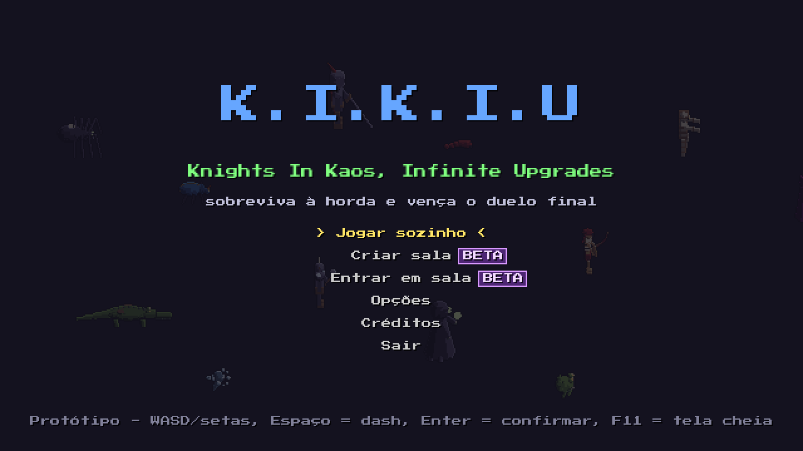
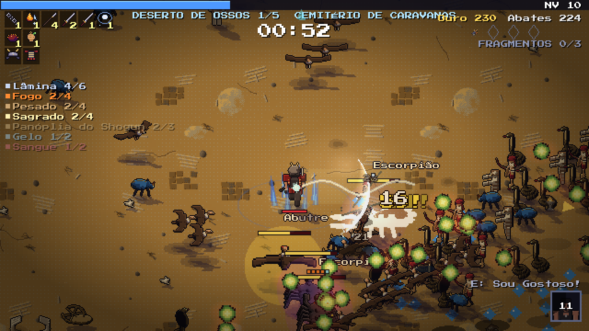
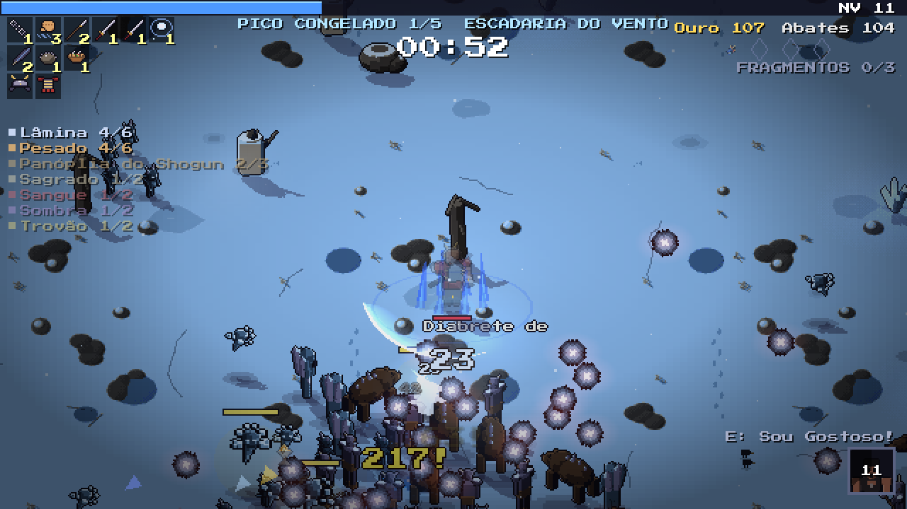
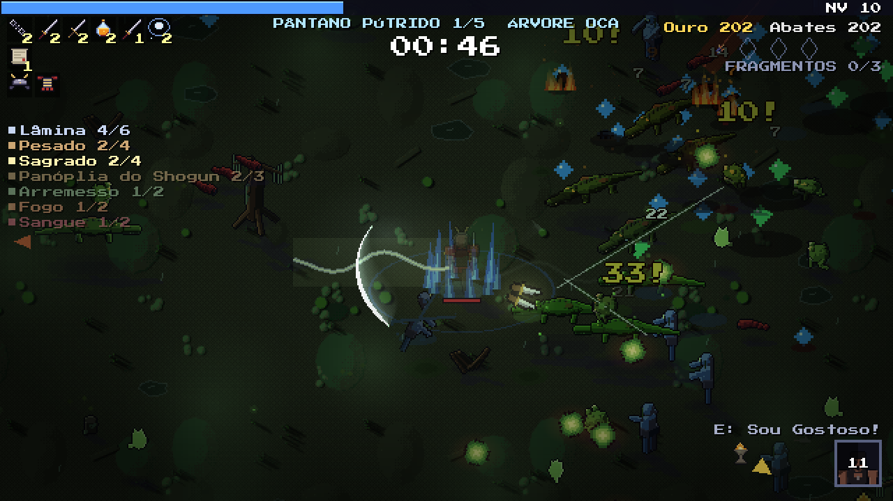
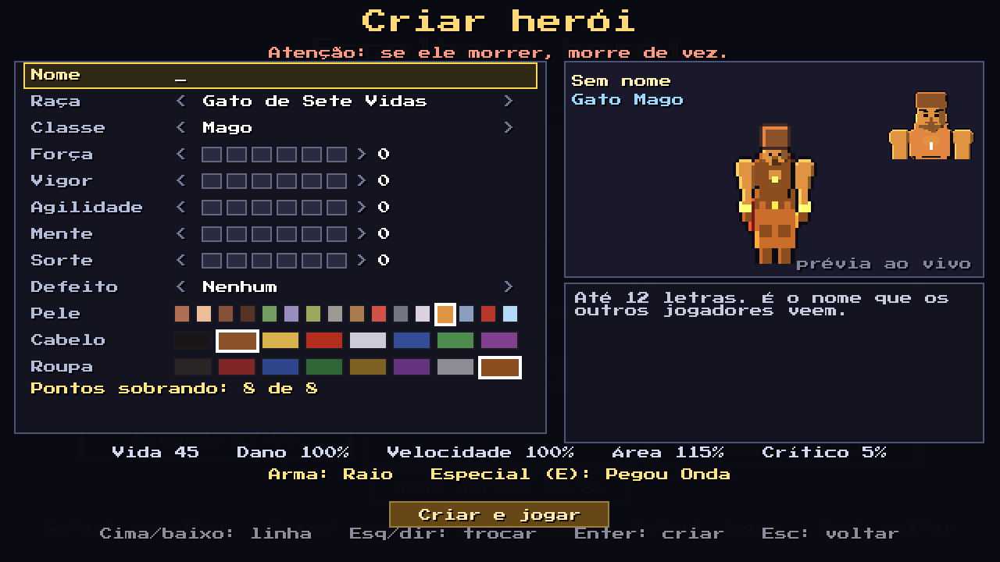

# ⚔️ K.I.K.I.U

### *Knights In Kaos, Infinite Upgrades*

**Sobreviva à horda com os amigos e vença o duelo final entre vocês.**

---

## 🎮 O jogo

O K.I.K.I.U é um jogo de hordas em **pixel art com clima de fantasia sombria**. Você atravessa um mundo tomado pelo caos enquanto ondas de monstros fecham o cerco. As armas atacam sozinhas; o seu trabalho é se mexer, esquivar, escolher as melhorias certas a cada nível e montar uma combinação que aguente o tranco.

Tudo é feito para jogar **com os amigos**. Até seis pessoas atravessam o mundo juntas, levantam quem caiu e dividem a mesma horda. Quando o último chefe cai, a amizade acaba: começa o **duelo final**, todos contra todos numa arena que vai fechando, e só um sai de pé.

  

## 🗺️ Um mundo em cinco regiões

Cada partida atravessa cinco regiões, com cinco andares cada. Cada uma tem os seus monstros, o seu clima e o seu chefe:

| | Região | |
|:---:|---|---|
| 🌲 | **Floresta Sombria** | Árvores retorcidas e coisas que andam entre elas. |
| 🐊 | **Pântano Pútrido** | Lama, névoa verde e afogados que não ficaram no fundo. |
| 🏜️ | **Deserto de Ossos** | Sol que não se põe, caravanas mortas e tumbas abertas. |
| 🏔️ | **Pico Congelado** | Vento que corta, gelo que não derrete e gigantes enterrados. |
| 🏰 | **Reino Sombrio** | Onde o caos começou. O mais cabuloso de todos. |

| | |
|:---:|:---:|
|  |  |
| **Pico Congelado** | **Pântano Pútrido** |

## 🧙 Heróis

Dá para jogar com os heróis da turma, cada um com seu jeito e seu golpe especial, ou **criar o seu do zero**: escolha a raça (de anão e elfo sombrio a capivara, gato e pombo), a classe, os atributos, um defeito para ganhar pontos extras e a aparência.

Herói criado tem uma regra só: **se ele morrer, morre de vez**. Ele sai com itens do baú na mochila e, se vencer, traz para casa o que encontrou pelo caminho. Se perder, perde tudo. No online, a corrida só está perdida quando o grupo inteiro cai.

  

## ✨ O que tem dentro

- 🗡️ **Dezenas de armas** que atacam sozinhas, de lâminas e machados que voltam até raios, corvos e runas, e que **evoluem** quando encontram o item certo.
- 🔥 **Elementos que se misturam:** fogo, gelo, raio e veneno, com reações quando dois se encontram.
- 🌀 **Rolamento de esquiva** com fôlego: dá para rolar através do perigo, mas não o tempo todo.
- 👹 **Cerca de 50 monstros**, chefes no fim das regiões e um soberano esperando no fim de tudo.
- 🎯 **Objetivos, santuários e baús** espalhados pelo caminho.
- 🤝 **Reviver no online:** quem cai vira corpo, e um amigo perto pode levantá-lo.
- 🏟️ **Duelo final** equilibrado, para que a vitória dependa de jogar bem, não só de quem teve mais sorte nas cartas.

## 📌 Situação

O jogo está **em desenvolvimento** e roda no Windows. As versões de teste circulam entre a turma conforme cada parte fica pronta. O online já funciona e ainda está em fase de testes.

## 🗂️ Outros projetos aqui

Este repositório também guarda dois projetos irmãos:

- 🎓 **JOGO da Cairu:** histórias engraçadas e verdadeiras do Breno na Faculdade Cairu, em Salvador, contadas em cenas com diálogo, voz e minijogos. Está pausado. Detalhes em [`jogos/cairu/`](jogos/cairu/README.md).
- 🎮 **K.I.K.I.U no PS Vita:** uma versão do jogo para o portátil da Sony, em testes iniciais.

Para quem quer abrir o projeto, rodar ou contribuir, cada parte tem o seu próprio guia: [o jogo](jogos/hordas/README.md), [a Cairu](jogos/cairu/README.md), [a documentação](docs/README.md) e [como colaborar](CONTRIBUTING.md).

## 👥 Equipe

| | Quem | Frente |
|:---:|---|---|
| 🎮 | **Breno** · [@brenoalmeidatec](https://github.com/brenoalmeidatec) | Criador, histórias e mecânicas |
| 🎨 | **Alisson** · [@LightWolfMan](https://github.com/LightWolfMan) | Visual, online e revisão |
