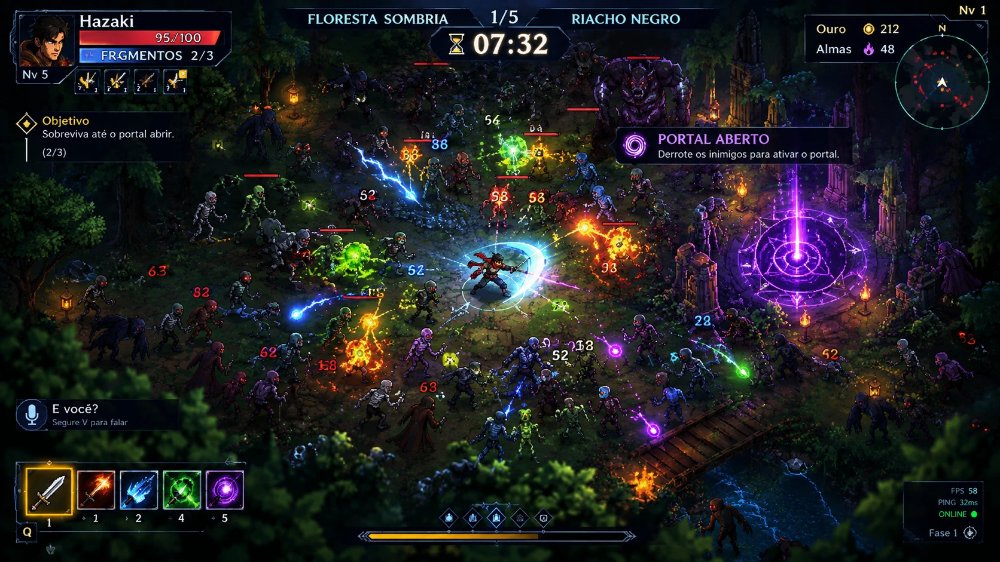

# Direção visual 2.5D do K.I.K.I.U

**Decisão confirmada pelo Alisson em 2026-10-10.** Daqui pra frente, toda arte, tela e efeito novo segue esta direção. Ela **substitui** a direção "chibi estilo Tiny RPG" da #132 e fecha a pergunta da #145: o jogo vira **2.5D**.

   
  Referência oficial do visual (imagem-conceito). É o alvo de aparência, não um arquivo para copiar.

## O que é "2.5D" aqui
O jogo **continua 2D por dentro** (Godot 4.4.1, sprites gerados pelo nosso pipeline Blender → pixel art), mas **parece ter volume e profundidade**. Isso vem de:
- **Câmera 3/4:** vista de cima inclinada, com primeiro plano (árvores, ruínas e folhagem cobrindo as bordas da tela), chão no meio e fundo.
- **Luz dinâmica de verdade:** lanternas, tochas, portal, magias e golpes acendem o chão e os bichos em volta. Os sprites ganham relevo com normal map (#145, #148).
- **Pixel art mais densa:** mais mundo na tela e personagens menores em relação à tela, com mais detalhe por pixel.
- **Efeitos fortes e coloridos por elemento:** raio azul, fogo laranja, veneno verde, arcano roxo. Os números de dano ganham as mesmas cores.
- **HUD de alta resolução** desenhado por cima do mundo pixelado, com painéis escuros translúcidos, bordas finas ornamentadas e texto nítido.

## Regras que valem já
1. **A referência manda.** Na dúvida, compare com `docs/imagens/referencia_2_5d.webp`.
2. **O pipeline é o nosso, e arte livre ajuda:** heróis, monstros e cenários continuam saindo do Blender (`fonte_arte/modelos3d/`). **Nada de arte com direitos autorais** (sem licença de uso livre). Arte de terceiros de **livre uso** (CC0, domínio público, CC BY com crédito etc.) **pode e deve** entrar quando economiza esforço e combina com o nosso contexto (estilo, escala e luz do jogo): as condições e o registro obrigatório estão em [`docs/LICENCAS_ARTE.md`](../LICENCAS_ARTE.md). Pack pago só com o OK do Breno (regra revista em 2026-10-12; antes: #132 e #116).
3. **Desempenho:** o perfil **Baixo** continua rodando no PC do trabalho do Breno (i5-3470, vídeo fraco). **Médio e Alto** levam os efeitos completos, inclusive a luz com relevo. A aba de Gráficos (#150) controla isso.
4. **Legibilidade antes de beleza:** o herói, os objetivos e o portal sempre se destacam. Os monstros têm olhos acesos (vermelhos) para se lerem no escuro. Elite e chefe têm barra de vida (Marco 1).
5. **Tudo orientado a dados** (`dados/*.json` com `_ajuda`), como o resto do jogo.

## Documentos desta pasta
| Arquivo | Assunto |
|---|---|
| [`hud_menus.md`](hud_menus.md) | Layout do HUD e dos menus medido na referência: posições, tamanhos, cores, fontes e molduras |
| [`mundo.md`](mundo.md) | Câmera, escala e resolução, luz, efeitos, monstros e cenário |
| [`lacunas.md`](lacunas.md) | Comparação entre o jogo de hoje e a referência, e o que muda em cada sistema, com esforço |
| [`paleta.json`](paleta.json) | Cores tiradas da referência (UI, luz, elementos) |

## Ordem de execução (fases visuais)
Cada fase é um PR ou mais, com print antes/depois na mesma cena e medição no perfil Baixo.

| Fase | O quê | Encaixe no plano |
|---|---|---|
| **V0** | Preparação: estes documentos, paleta e issues | agora |
| **V1** | Base: resolução e escala do mundo, câmera 3/4 com primeiro plano, e HUD novo no layout da referência | antes do Marco 4 |
| **V2** | Luz dinâmica com relevo nos sprites (2ª rodada da #145) e luzes do cenário | junto da aba de Gráficos (#150) |
| **V3** | Cenário com profundidade: ruínas, pontes, água, lanternas e altura no mapa | Marco 4 (#128) |
| **V4** | Heróis e monstros renderizados de novo na densidade nova, com retratos pintados em pixel | Marco 8 (#132) |
| **V5** | Efeitos por elemento, números de dano coloridos e golpes com arco de luz | Marcos 6 e 8 |
| **V6** | Menus todos no mesmo visual (título, heróis, preparo, mapa, opções, status) | Marco 8 (#132) |

O que aparece na referência e só entra depois: **chat de voz** e **ping/online** (Marco 9, #133), **minimapa** (Marco 4, #128) e **almas** (Marco 7, #131).
