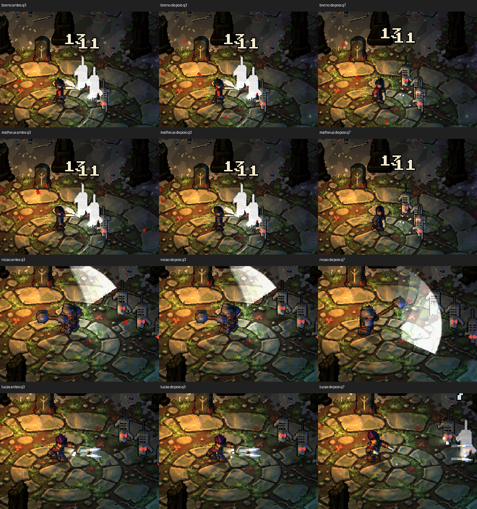

# Corpo dos golpes: preparo e recuperação

Refs #304 e #342. Base de produto: `68bf0230bde1f69652bae947017309d65fa9a0f9` (PR #394, dependência desta frente).

O envelope anterior começava recuado dois pixels, voltava a zero antes do acerto e saltava para a frente quando `_punch` era ativado. O novo envelope usa a fase já existente do golpe: posição zero no início, −2 px na metade da antecipação, +3 px em `acerto_em`, zero ao terminar. Cada trecho usa smoothstep, com velocidade zero nas junções. A escala vai de (1,1) até o teto existente (1,10;0,93) e volta a (1,1). Só o vetor final é arredondado; o filtro nearest permanece. Não há relógio ou estado extra para vazar para o próximo combo, E/Q, rolamento, escudo ou morte.

O avanço físico, a animação da folha, o relógio de acerto e o disparo dos efeitos continuam nos mesmos trechos. A recuperação volta a zero antes do próximo preparo. O rastro da katana e os efeitos da marreta/adagas são os existentes; nenhuma arte, pool ou regra de combate foi criada aqui. `alcance_ima` não foi alterado.

## Comparação por passos reais

`testes/fotos/contrato_golpes.tscn` monta personagens ativos, inclusive **Matheus com mecânica Hazaki e folha matheus**, e avança o mundo real com inimigo vivo (1 milhão HP, peso alto para mantê-lo alcançável). Semente 7; sem crítico, diretor, movimento ou entrada de usuário. Segura ataque por três golpes e acompanha três segundos, tanto em 60 quanto em 120 Hz. APPDATA de QA separado, nunca o perfil real.

O mesmo harness foi executado antes de editar produção e depois. `contrato.json` registra os oito casos, hashes dos traços iguais e cada evento de dano com passo e hit-stop. Foram comparados exatamente, por passo: posição física do herói e inimigo, estado, índice/tempo/duração/acerto do golpe, quantidade de golpes, fôlego, HP, acertos corpo a corpo/adagas, adagas ativas e pausa local; também RNG final, coluna da folha e todos os contadores FX. **Todos iguais** (180 passos por caso a 60 Hz; 360 a 120 Hz). Apenas posição e escala desenhadas do corpo mudaram.

Para reproduzir, copie somente o harness `.gd/.tscn` para a base (sem o helper visual novo), rode cada referência com `--saida=antes.json` ou `--saida=depois.json`, e execute `python ferramentas/comparar_golpes.py antes.json depois.json resumo.json`. Toda execução Godot neste notebook deve passar pelo wrapper `godot_fila.ps1`; use APPDATA temporário próprio. O comparador aborta se encontrar qualquer diferença contratada.

## Capturas

Os oito GIFs desta pasta vêm dos helpers isolados `matheus_gif` (`--ativo=breno` e `--ativo=matheus`) e `heroi_gif` (`--heroi=nicao` e `--heroi=lucas`), sempre `--cena=combo`. Mesmos passos e semente antes/depois. Cada quadro representa dois passos de 1/60 s; GIF em 30 fps aproximados, resolução nativa, paleta 128 cores sem dithering. O PNG de contato preserva cores completas e usa nearest 2×. Os helpers têm alvos que se movem com empurrão, enquanto o contrato usa peso alto; são provas complementares.

| Visual | Antes | Depois |
| --- | --- | --- |
| Hazaki/Breno | [GIF](breno_antes.gif) | [GIF](breno_depois.gif) |
| Matheus | [GIF](matheus_antes.gif) | [GIF](matheus_depois.gif) |
| Nicão | [GIF](nicao_antes.gif) | [GIF](nicao_depois.gif) |
| Lucas | [GIF](lucas_antes.gif) | [GIF](lucas_depois.gif) |

`v2_golpes_visuais` prova rastro visível e pausa curta em acertos reais corpo a corpo, ondas da pancada e adagas ativas com cauda no impacto. **Limite do envelope:** o Lucas legado não chama `hit_stop` em alvo vivo (`adagas._acertar` → `combate.ferir`); o contrato preserva zero. Isso não equivale a cumprir o pedido de hit-stop dos quatro, e uma eventual mudança mecânica deve ter commit e evidência próprios.

Os processos concluíram com código 0; os helpers e testes emitiram avisos de recursos/RID no encerramento já presentes na base. Não houve `SCRIPT ERROR`. Capturas não são benchmark de FPS nem avaliação subjetiva por controle físico.
