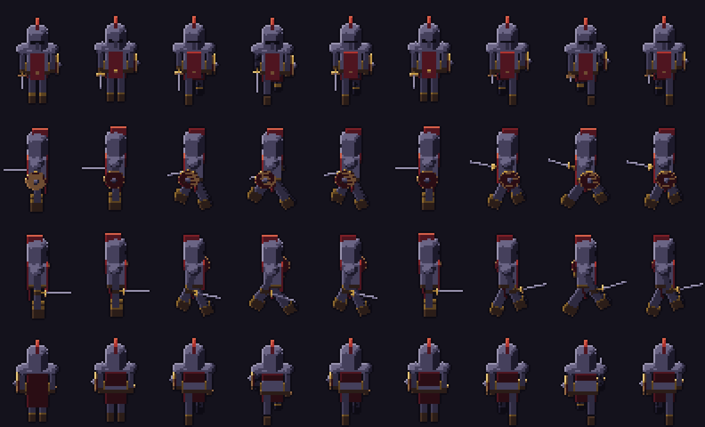

# ⚔️ K.I.K.I.U — guia técnico

Apresentação do jogo no [README principal](../../README.md). Aqui fica o que é preciso para abrir, testar e gerar o executável.

## 🚀 Como rodar

1. 📥 Baixe o **Godot 4.4.1 (padrão, não .NET)**: <https://godotengine.org/download/archive/4.4.1-stable/>
2. 📂 Clone o repositório.
3. ➕ No gerenciador de projetos do Godot, clique em **Importar** e escolha `jogos/hordas/projeto/project.godot`.
4. ⏳ Na primeira vez o Godot importa imagens e sons (demora um pouco). Depois, **F5** roda o jogo.

O projeto usa o renderer *Compatibility*, tela base 640×360 com escala inteira (pixel art sem borrar).

## 🧪 Testes automáticos

Cada cena em `projeto/testes/` é um teste que roda sozinho e imprime `falhas=0` quando passa:

```bash
godot --headless --path jogos/hordas/projeto res://testes/rolamento.tscn
```

Um robô também joga sozinho, para medir desempenho e pegar erros de script:

```bash
# um robô joga sozinho, mais rápido, e mostra os números a cada 5 s
godot --headless --path jogos/hordas/projeto -- --bot --heroi=nicao --sair=700 --rapido=4

# online com 2 instâncias na mesma máquina (abra o anfitrião primeiro)
godot --headless --path jogos/hordas/projeto -- --online=host --bot --heroi=nicao --sair=300 --rapido=4
godot --headless --path jogos/hordas/projeto -- --online=join --endereco=127.0.0.1:7777 --bot --heroi=lucas --sair=300 --rapido=4
```

Outras opções (`--fase`, `--build`, `--estresse`, `--imortal`, `--print_tela`...) estão comentadas no começo de `projeto/scripts/hordas/main.gd` (as de foto, junto da função `_print_tela`). A animação dos heróis (respiração, passo, golpe, recuo e queda) se ajusta em `projeto/dados/animacao.json` (a `_ajuda` explica cada chave); `--print_tela=animacao --heroi=X --cena=parado|andar|golpe|dano|morte --seq=...` tira uma tira de recortes pra conferir.

## 📦 Gerar o executável (.exe)

Executáveis e zips **não** ficam no Git. No Godot: **Projeto › Exportar › Windows Desktop** (o preset já está em `projeto/export_presets.cfg`; precisa dos modelos de exportação do 4.4.1).

## 📂 Estrutura

| Pasta | O que é |
|---|---|
| `projeto/scripts/hordas/` | O código do jogo (GDScript). `armas/` tem um arquivo por tipo de arma. |
| `projeto/dados/*.json` | Todo o conteúdo: heróis, raças, classes, armas, monstros, regiões, duelo. Mudar o jogo quase sempre é mexer só aqui; cada arquivo explica os campos no `_ajuda`. |
| `projeto/assets/` | Imagens e sons já prontos para o jogo. |
| `projeto/testes/` | Testes automáticos (uma cena por assunto). |
| `fonte_arte/` | Geradores da arte. `modelos3d/` monta heróis, monstros e cenários no Blender e renderiza em pixel art. |
| `fonte_audio/` | Scripts que geram e preparam as músicas. |
| `LEIA-ME.txt` | Regras e controles em texto (parte dele ainda descreve o tema antigo). |

## 🎨 Arte: do 3D ao pixel art

A arte sai de **modelos 3D renderizados como pixel art** no Blender 4.5 LTS: render no tamanho final sem antialiasing, sombreado em faixas, paleta fixa, luz de borda e contorno de 1 px, com a mesma luz das sombras do jogo.

<p align="center">
  <br>
  <sub>4 direções × 9 quadros, gerado por <code>fonte_arte/modelos3d/cavaleiro.py</code></sub>
</p>

```bash
blender -b -P jogos/hordas/fonte_arte/modelos3d/cavaleiro.py
```

Os monstros de 5 vistas (`horror.py`, `floresta.py`, `pantano.py`, `deserto.py`, `gelo.py`, `reino.py`) saem com um ciclo de andar de 6 quadros mais o branco de dano; o jogo anda o ciclo pela distância percorrida. Quadros por folha, inclinação, quique, aperto de golpe e preparo de investida ficam em `projeto/dados/animacao_monstros.json`. Para regerar: `blender -b -P jogos/hordas/fonte_arte/modelos3d/<regiao>.py` (as 6 regiões podem rodar em paralelo; atualiza `dados/quadros_monstros.json`).

Técnicas e referências em [`docs/VISUAL_KIKIU.md`](../../docs/VISUAL_KIKIU.md); o resto da documentação está no [índice de `docs/`](../../docs/README.md).
