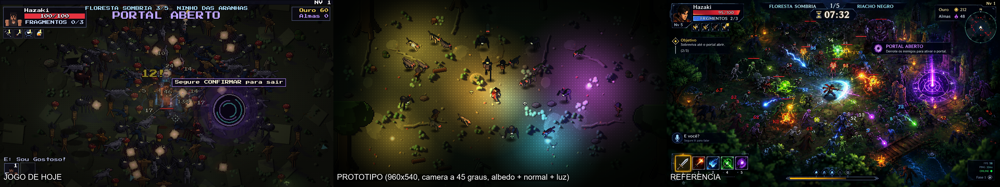
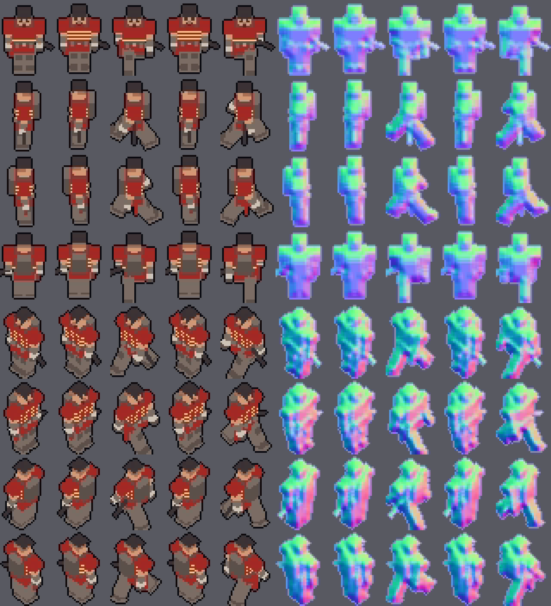
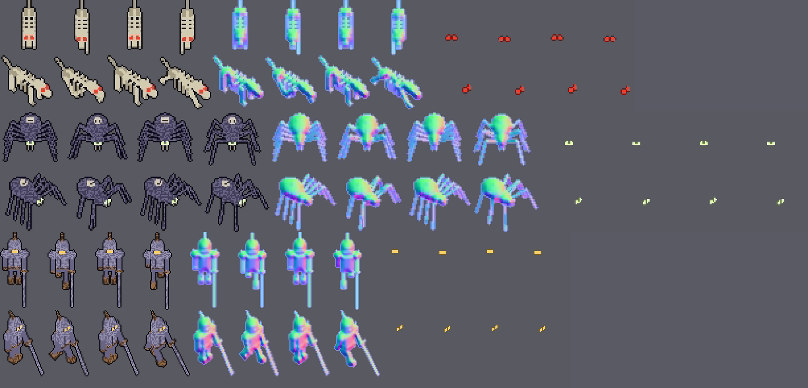
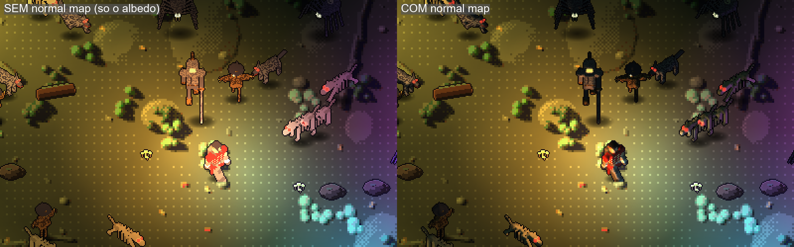

# Protótipo da "cara nova" (V1 + V2): câmera a 45 graus, escala nova e luz com relevo

Protótipo **isolado** (nada de `main.gd`, `arena.gd`, `assets/` do jogo ou `dados/` foi tocado) para o Alisson e o Breno aprovarem antes de regenerar os ~50 monstros e os heróis. Issue #152; direção em `docs/visual_2_5d/`.

  

## O que tem aqui

| Arquivo | O que é |
|---|---|
| `gerar_cara_nova.py` | Gerador (Blender 4.5). Reaproveita o modelo 3D de `hazaki.py`, `horror.py` e `floresta.py` e troca **só em memória** o que muda: materiais, câmera, escala e pós-processo. `pixel3d.py`, `hazaki.py`, `monstros.py`, `horror.py` e `floresta.py` ficam intactos. |
| `gerar_tudo.sh` | Gera tudo (herói e 5 monstros) em paralelo: ~3 min. |
| `sprites/` | Saída: por sprite, `_albedo.png`, `_normal.png`, `_emissao.png` e `.json` (tamanho do quadro, linhas e colunas). |
| `prever.sh` | Monta a prévia albedo / normal / emissão de uma folha (para olhar). |
| `medir_fps.sh` e `fps.txt` | Medição de fps na Iris Xe (3 repetições). |
| `../../projeto/prototipos/cara_nova.tscn` + `.gd` | A cena de teste em 960x540 (só para o print e a medição). |

Para ver: `godot --path jogos/hordas/projeto res://prototipos/cara_nova.tscn` (janela real). Opções após `--`: `--fotos=PASTA --seq=1.2,2.6` (prints do viewport), `--medir --luzes=3 --sprites=250`, `--sem_normal` (compara), `--basico` (herói sem a armadura vermelha), `--amb=1c2a24`, `--h_tocha=45`, `--chao=1`.

## Cada sprite sai em 3 imagens, no mesmo enquadramento

1. **Albedo**: só a cor, na paleta do jogo, com o contorno escuro de 1 px. **Sem faixas de sombra e sem luz de borda assada**: cada material é uma cor chapada (o `ruido` do toon antigo virou manchas de 2 tons da própria cor, que é textura e não sombra).
2. **Normal map**: normal em espaço de câmera (R = x, G = y para cima, B = z), mesma convenção validada no PR #148 (domo de teste). Desfaz a elevação da câmera (frente vertical = `(0, 0, 1)`, topo = `(0, 1, 0)`), exagera a inclinação XY (`ESTICA`), soma um bisel de borda (`BISEL`) e suaviza 1 passe 3x3 para a caixa não parecer facetada. O contorno de 1 px vira normal reta.
3. **Emissão** (só o que brilha): olhos e chamas na cor exata + 1 px de halo mais escuro. Fora disso, transparente. É assim que o monstro se lê no escuro: no Godot ela é desenhada **aditiva e sem luz** (ver "Limitações").

O alfa é o mesmo nas três (mesmo render, mesmo limiar); a normal é espelhada junto com o sprite dos monstros (o gerador original renderiza olhando para a esquerda e espelha; o canal X da normal inverte junto).

Folhas: **Hazaki** (`hazaki_albedo.png` etc., e `hazaki_samurai_*` com a armadura vermelha, que o protótipo usa porque o preto da regata some no escuro) com 8 direções x [parado, andar 0, 2, 4, 6] em quadros de **32x44**; **cão de ossos, aranha tecelã, espantalho, lobo sombrio e cavaleiro oco** (o último faz o papel de elite), com 2 vistas (frente e 3/4 frente-direita; o outro lado é espelho) x 4 quadros de andar.

## Parâmetros (todos no topo de `gerar_cara_nova.py` ou em `cara_nova.gd`)

| Parâmetro | Hoje | Protótipo | Observação |
|---|---|---|---|
| Elevação da câmera | 32 graus | **45 graus** | a referência mede ~50; 45 foi a recomendação do `mundo.md` |
| Pixels por unidade do Blender (`PPU`) | 23,53 | **24,5** | ver o achado de escala abaixo |
| Quadro do herói | 44x60 | **32x44** | pé na linha 42 (antes 57); arte de **39 px** de altura |
| Quadro dos monstros | tabela (`W`, `H`) | cresce até caber | cão 40x42, aranha 51x46, espantalho 38x46, lobo 38x45, cavaleiro 45x74 |
| Normal: `ESTICA` / `BISEL` / `SUAVIZA` | (#148: 2,0 / 0,8 / 0) | 2,0 / 0,9 (3 px) / 1 passe | escolhas de arte |
| Cor do albedo | toon x 3 faixas | cor base elevada a 0,6 (linear) | levanta os escuros (quitina, regata preta) sem estourar os claros |
| Olhos e chamas | 1x | engrossados 1,25x no modelo | a 24 px/u um olho de 0,05 u some |
| Mundo | 640x360 | **960x540** (aprovado pelo Breno) | janela 1280x720 só para ver; o print sai do viewport em 960x540 |
| `CanvasModulate` | | `#1c2a24` | |
| Luz 1: tocha quente junto do herói | | `#ff9e42`, energia 2,5, raio ~200 px, **altura 45** | pisca com seno |
| Luz 2 e 5: lanternas | | `#ffb84d`, energia 2,0 e 1,9, raio ~200 px, **altura 60** | fixas |
| Luz 3: magia roxa | | `#c740ff`, energia 2,3, raio 230 px, **altura 60** | fixa |
| Luz 4: magia azul | | `#40a6ff`, energia 2,3, raio 170 px, **altura 60** | gira em volta |
| Luz 6: aura fria do herói | | `#73b8ff`, energia 1,2, raio 110 px, **altura 60** | à direita do herói |
| Chão | `piso.png` x2 | `piso.png` x2 com ganho 2,4 e tom verde | o chão da Floresta já é quase preto |

### Achado: a escala do herói quase não muda, o que muda é o quadro
O `mundo.md` calcula "herói 16,7% da tela" pelo **quadro** de 60 px, mas a arte do Hazaki velho tem **44 px de altura** dentro desse quadro (sobram 16 px de margem morta em cima; medido no alfa de `andando_8.png`). Em 960x540 esses 44 px já dão **8,1%** da altura, exatamente o da referência (7,9%). Com a câmera a 45 graus o corpo encurta na vertical (cos 45 < cos 32), e com o `PPU` quase igual ao de hoje (24,5) o herói sai com **39 px (7,2%)**. Ou seja: a "redução a 0,73x" prevista não é necessária, e fazê-la deixaria o herói com ~29 px (5,4%), pequeno demais. O que encolhe é o quadro (44x60 para 32x44), o que reduz memória e overdraw.

## Resultado visual (prints conferidos em janela real)

- `prints/prototipo_cara_nova_comparacao.png`: hoje | protótipo | referência.
- `prints/prototipo_cara_nova_cena_1..3.png`: a cena em 3 instantes (tocha tremendo, magia azul girando).
- `prints/prototipo_cara_nova_com_vs_sem_normal.png`: o mesmo quadro sem e com normal map.

**O que funcionou:** com albedo sem sombra assada o normal map **aparece de verdade**. No lado "sem normal" tudo recebe a mesma luz chapada (como hoje); no lado "com normal" cada bicho tem um flanco aceso pela luz mais próxima (laranja de um lado, roxo ou azul do outro) e o outro lado escurece, e o herói fica quente à esquerda e frio à direita. Isso resolve a queixa do #148 (efeito sutil): a causa era mesmo a sombra pintada na cor. Os olhos acesos (vermelhos, âmbar, verde-pálido) leem bem no escuro.

**O que não funcionou ou ficou a desejar:**
- Quem tem material escuro (cavaleiro oco de aço, aranha) vira silhueta com borda iluminada fora das poças de luz. É o efeito pretendido, mas na horda isso pede mais luz ou albedo mais claro por família.
- Luz com normal é **mais escura** que sem normal (N·L = altura/distância na face plana). Compensei com alturas de luz de 45 a 60 px (a 22 a 26 o lado com relevo ficava preto) e energia mais alta. Altura é o botão entre "contraste forte" e "legível".
- Perto da referência no **clima** (poças de luz colorida sobre fundo escuro, bichos acesos de um lado) e longe em **densidade** (a referência tem 60+ bichos, vegetação verde saturada, efeitos de magia, ruínas e portal) e em **cor do cenário**. O chão da Floresta de hoje é quase preto e marrom, e o enfeite é esparso. Isso é V3 (cenário) e V5 (efeitos), não do gerador de sprites.
- Sem sombra projetada (sem `LightOccluder2D`, como recomendado).

## Fps (Intel Iris Xe, notebook, janela 1280x720 com viewport 960x540, sem V-Sync)

{{FPS}}

## O que muda no gerador real quando for aprovado

1. `pixel3d.camera`: `elevacao_graus` 32 -> 45 (uma linha, vale para todos os chamadores; cenários e chão têm de ir junto para o pé e o chão combinarem).
2. Escala: `PPU` 60/2,55 -> 24,5 e quadros novos (herói 32x44, pé na linha 42; monstros: dividir `W` e `H` da tabela por ~1,25 e deixar crescer até caber). **Atenção:** `dados/animacao_monstros.json`, `quadros_monstros.json` e o `jogador.gd` (44x60, `PE_Y`) guardam o tamanho do quadro.
3. Passo novo no `pixelar`: `luz_borda=False` e **sem toon**: `material_toon` vira albedo chapado (`_albedo` do `gerar_cara_nova.py`). Escuros levantados com `cor ** 0,6`.
4. Gerar **albedo + normal** de cada sprite (o `gerar_cara_nova.py` já faz os 3 passes na mesma cena: o render dobra ou triplica, ~1,5 a 3 s por quadro do herói e menos para monstros; os 50 monstros em paralelo cabem em ~15 min).
5. Emissão (olhos e chamas) como terceiro PNG, só para quem tem emissivo.
6. No Godot: `CanvasTexture` (difusa + normal) nos sprites, **olhos aditivos fora do `CanvasModulate`** (ver "Limitações"), luz de `PointLight2D` com altura 45 a 60 e os limites por perfil de `qualidade.json`.

## Limitações do protótipo (para quem for integrar)

- **Olhos e orbes de luz**: o `CanvasModulate` escurece tudo na mesma camada, inclusive um sprite aditivo de olhos. No protótipo os olhos e os orbes ficam numa `CanvasLayer` à parte, sincronizados à mão com o dono. No jogo, onde a horda é MultiMesh, o caminho barato é um `shader_type canvas_item` com `unshaded` + textura de emissão (ou um segundo MultiMesh aditivo só dos olhos).
- A horda atual é um MultiMesh (`inimigos.gd`): normal map nele exige o shader do lote ler a segunda textura. O protótipo usa `Sprite2D` comum, então o fps abaixo é de `Sprite2D`, não do MultiMesh.
- O protótipo mostra 5 famílias de monstro, não os 50. Os heróis fora do Hazaki não foram gerados.
- Pixels do chão em escala 2 e dos sprites em 1: igual ao jogo de hoje. Na referência o pixel é uniforme; decidir na V3.
