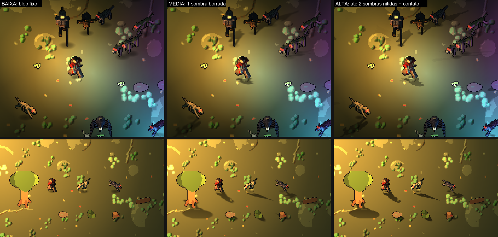
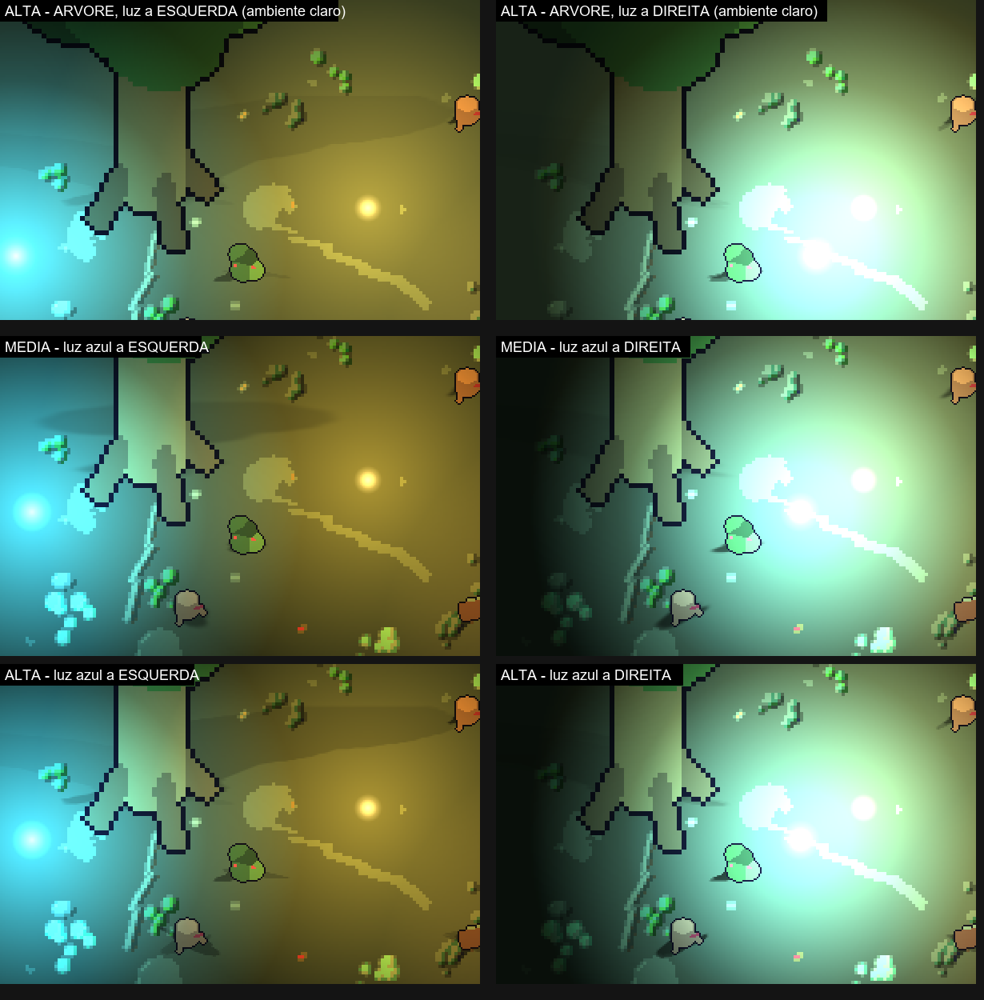
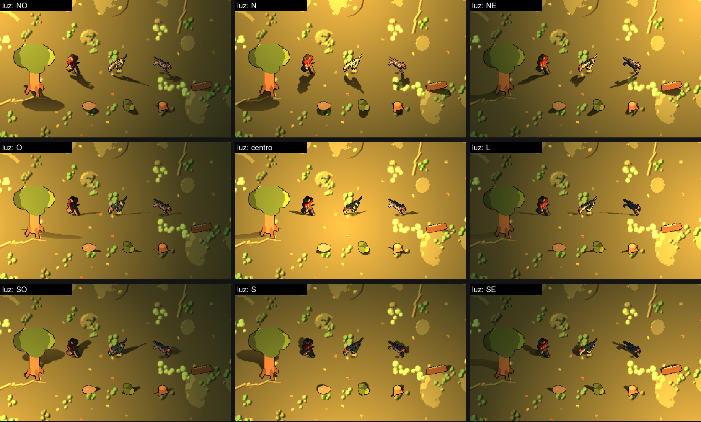
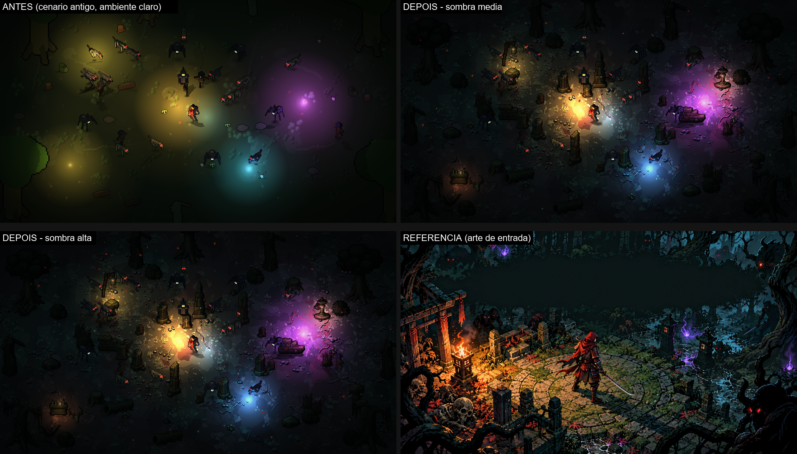
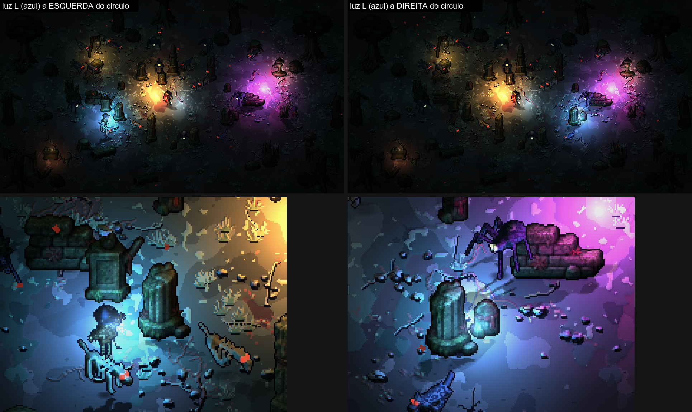
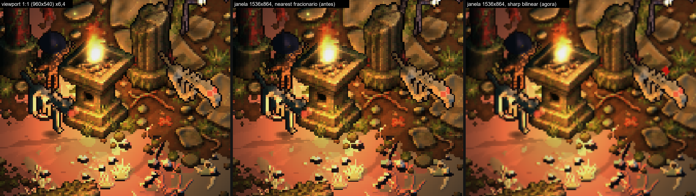

# Protótipo da "cara nova" (V1 + V2): câmera a 45 graus, escala nova e luz com relevo

Protótipo **isolado** (nada de `main.gd`, `arena.gd`, `assets/` do jogo ou `dados/` foi tocado) para o Alisson e o Breno aprovarem antes de regenerar os ~50 monstros e os heróis. Issue #152; direção em `docs/visual_2_5d/`.

  

## O que tem aqui

| Arquivo | O que é |
|---|---|
| `gerar_cara_nova.py` | Gerador (Blender 4.5). Reaproveita o modelo 3D de `hazaki.py`, `horror.py` e `floresta.py` e troca **só em memória** o que muda: materiais, câmera, escala e pós-processo. `pixel3d.py`, `hazaki.py`, `monstros.py`, `horror.py` e `floresta.py` ficam intactos. |
| `gerar_tudo.sh` | Gera tudo (herói e 5 monstros) em paralelo: ~3 min. |
| `sprites/` | Saída: por sprite, `_albedo.png`, `_normal.png`, `_emissao.png` e `.json` (tamanho do quadro, linhas e colunas). |
| `prever.sh` | Monta a prévia albedo / normal / emissão de uma folha (para olhar). |
| `medir_fps.sh` e `fps.txt` | Medição de fps na Iris Xe (3 repetições). |
| `gerar_cenario_cara_nova.py` | Gerador (Blender 4.5) do chão e dos enfeites da Floresta **sem sombra assada** (ver "Sombras em tempo real"). |
| `medir_sombras.sh` e `fps_sombras.txt` | Medição de fps por modo de sombra. |
| `../../projeto/prototipos/cara_nova.tscn` + `.gd` | A cena de teste em 960x540 (janela livre, prints do viewport e medição). |
| `../../projeto/prototipos/teste_sombra_cara_nova.gd` | Teste automático da direção da sombra (8 posições de luz, varredura sem pulo). |

Para ver: `godot --path jogos/hordas/projeto res://prototipos/cara_nova.tscn` (janela real). Opções após `--`: `--fotos=PASTA --seq=1.2,2.6` (prints do viewport), `--medir --luzes=3 --sprites=250`, `--sem_normal` (compara), `--basico` (herói sem a armadura vermelha), `--amb=1c2a24`, `--h_tocha=45`, `--chao=1`.

## Cada sprite sai em 3 imagens, no mesmo enquadramento

1. **Albedo**: só a cor, na paleta do jogo, com o contorno escuro de 1 px. **Sem faixas de sombra e sem luz de borda assada**: cada material é uma cor chapada (o `ruido` do toon antigo virou manchas de 2 tons da própria cor, que é textura e não sombra).
2. **Normal map**: normal em espaço de câmera (R = x, G = y para cima, B = z), mesma convenção validada no PR #148 (domo de teste). Desfaz a elevação da câmera (frente vertical = `(0, 0, 1)`, topo = `(0, 1, 0)`), exagera a inclinação XY (`ESTICA`), soma um bisel de borda (`BISEL`) e suaviza 1 passe 3x3 para a caixa não parecer facetada. O contorno de 1 px vira normal reta.
3. **Emissão** (só o que brilha): olhos e chamas na cor exata + 1 px de halo mais escuro. Fora disso, transparente. É assim que o monstro se lê no escuro: no Godot ela é desenhada **aditiva e sem luz** (ver "Limitações").

O alfa é o mesmo nas três (mesmo render, mesmo limiar); a normal é espelhada junto com o sprite dos monstros (o gerador original renderiza olhando para a esquerda e espelha; o canal X da normal inverte junto).

Folhas: **Hazaki** (`hazaki_albedo.png` etc., e `hazaki_samurai_*` com a armadura vermelha, que o protótipo usa porque o preto da regata some no escuro) com 8 direções x [parado, andar 0, 2, 4, 6] em quadros de **32x44**; **cão de ossos, aranha tecelã, espantalho, lobo sombrio e cavaleiro oco** (o último faz o papel de elite), com 2 vistas (frente e 3/4 frente-direita; o outro lado é espelho) x 4 quadros de andar.

## Parâmetros (todos no topo de `gerar_cara_nova.py` ou em `cara_nova.gd`)

| Parâmetro | Hoje | Protótipo | Observação |
|---|---|---|---|
| Elevação da câmera | 32 graus | **45 graus** | a referência mede ~50; 45 foi a recomendação do `mundo.md` |
| Pixels por unidade do Blender (`PPU`) | 23,53 | **24,5** | ver o achado de escala abaixo |
| Quadro do herói | 44x60 | **32x44** | pé na linha 42 (antes 57); arte de **39 px** de altura |
| Quadro dos monstros | tabela (`W`, `H`) | cresce até caber | cão 40x42, aranha 51x46, espantalho 38x46, lobo 38x45, cavaleiro 45x74 |
| Normal: `ESTICA` / `BISEL` / `SUAVIZA` | (#148: 2,0 / 0,8 / 0) | 2,0 / 0,9 (3 px) / 1 passe | escolhas de arte |
| Cor do albedo | toon x 3 faixas | cor base elevada a 0,6 (linear) | levanta os escuros (quitina, regata preta) sem estourar os claros |
| Olhos e chamas | 1x | engrossados 1,25x no modelo | a 24 px/u um olho de 0,05 u some |
| Mundo | 640x360 | **960x540** (aprovado pelo Breno) | janela 1280x720 só para ver; o print sai do viewport em 960x540 |
| `CanvasModulate` | | `#1c2a24` | |
| Luz 1: tocha quente junto do herói | | `#ff9e42`, energia 2,5, raio ~200 px, **altura 45** | pisca com seno |
| Luz 2 e 5: lanternas | | `#ffb84d`, energia 2,0 e 1,9, raio ~200 px, **altura 60** | fixas |
| Luz 3: magia roxa | | `#c740ff`, energia 2,3, raio 230 px, **altura 60** | fixa |
| Luz 4: magia azul | | `#40a6ff`, energia 2,3, raio 170 px, **altura 60** | gira em volta |
| Luz 6: aura fria do herói | | `#73b8ff`, energia 1,2, raio 110 px, **altura 60** | à direita do herói |
| Chão | `piso.png` x2 | `piso.png` x2 com ganho 2,4 e tom verde | o chão da Floresta já é quase preto |

### Achado: a escala do herói quase não muda, o que muda é o quadro
O `mundo.md` calcula "herói 16,7% da tela" pelo **quadro** de 60 px, mas a arte do Hazaki velho tem **44 px de altura** dentro desse quadro (sobram 16 px de margem morta em cima; medido no alfa de `andando_8.png`). Em 960x540 esses 44 px já dão **8,1%** da altura, exatamente o da referência (7,9%). Com a câmera a 45 graus o corpo encurta na vertical (cos 45 < cos 32), e com o `PPU` quase igual ao de hoje (24,5) o herói sai com **39 px (7,2%)**. Ou seja: a "redução a 0,73x" prevista não é necessária, e fazê-la deixaria o herói com ~29 px (5,4%), pequeno demais. O que encolhe é o quadro (44x60 para 32x44), o que reduz memória e overdraw.

## Resultado visual (prints conferidos em janela real)

- `prints/prototipo_cara_nova_comparacao.png`: hoje | protótipo | referência.
- `prints/prototipo_cara_nova_cena_1..3.png`: a cena em 3 instantes (tocha tremendo, magia azul girando).
- `prints/prototipo_cara_nova_com_vs_sem_normal.png`: o mesmo quadro sem e com normal map.

**O que funcionou:** com albedo sem sombra assada o normal map **aparece de verdade**. No lado "sem normal" tudo recebe a mesma luz chapada (como hoje); no lado "com normal" cada bicho tem um flanco aceso pela luz mais próxima (laranja de um lado, roxo ou azul do outro) e o outro lado escurece, e o herói fica quente à esquerda e frio à direita. Isso resolve a queixa do #148 (efeito sutil): a causa era mesmo a sombra pintada na cor. Os olhos acesos (vermelhos, âmbar, verde-pálido) leem bem no escuro.

**O que não funcionou ou ficou a desejar:**
- Quem tem material escuro (cavaleiro oco de aço, aranha) vira silhueta com borda iluminada fora das poças de luz. É o efeito pretendido, mas na horda isso pede mais luz ou albedo mais claro por família.
- Luz com normal é **mais escura** que sem normal (N·L = altura/distância na face plana). Compensei com alturas de luz de 45 a 60 px (a 22 a 26 os bichos fora da poça ficavam quase pretos) e energia mais alta. Altura é o botão entre "contraste forte" e "legível".
- Perto da referência no **clima** (poças de luz colorida sobre fundo escuro, bichos acesos de um lado) e longe em **densidade** (a referência tem 60+ bichos, vegetação verde saturada, efeitos de magia, ruínas e portal) e em **cor do cenário**. O chão da Floresta de hoje é quase preto e marrom, e o enfeite é esparso. Isso é V3 (cenário) e V5 (efeitos), não do gerador de sprites.
- A sombra projetada veio depois (seção "Sombras em tempo real"), sem `LightOccluder2D`, como recomendado.

## Sombras em tempo real (silhueta projetada no chão, seguindo a luz)

Pedido do Alisson depois de aprovar o protótipo. A câmera é de 45 graus, então a sombra certa é a **silhueta do próprio sprite deitada no chão**, presa aos pés e apontando para longe da luz (não é `LightOccluder2D`, que faz raio infinito e fica errado nessa câmera).

**Como é feita (em `cara_nova.gd`):**
- Um `Sprite2D` de sombra por ator (herói, monstros **e cenário**: árvores, pedras, arbustos, tocos, troncos, cogumelos, crânio) com a mesma textura e o mesmo quadro do albedo, usando só o alfa. Preto, `unshaded`, `light_mask = 0`, numa camada abaixo de todos (`z_index -50`, agrupada por textura para não quebrar lote). O quadro e o `flip_h` acompanham a animação e o espelhamento do sprite.
- **Cisalhamento a partir dos pés, nunca rotação:** `x_axis = (esc, 0)`, `y_axis = -vec * esc`, `origin = pés`, onde `vec = d * L / H` (d = direção da sombra no chão, com o y achatado por sen 45; L = comprimento; H = altura do sprite). Luz ao norte espelha a silhueta na vertical (certo: a sombra vem para a câmera); sem escala negativa (o espelho dos monstros é o `flip_h`).
- **Comprimento:** `L = H * dist / max(h_luz * 2,2 - H/2, 8)`, limitado a [0,08 H, 1,5 H] (cenário 1,6 H; árvore 0,8 H). Luz baixa e longe = sombra longa; luz em cima vira mancha. `h_luz` é a altura `h_*` da luz (espaço do normal map); o fator 2,2 converte para a altura que ela rende na tela a 45 graus.
- **Luz:** o peso de cada luz sobre o ator é `energia x atenuação` (mesma curva do gradiente da `PointLight2D`, dentro do alcance). Fora de qualquer luz só sobra o blob fraco.
- **Sem pulo:** o vetor e o alfa andam até o alvo com `1 - exp(-12 dt)` (o tremor da tocha mexe no máximo no alfa). No modo alto cada sombra segue a sua luz enquanto ela estiver entre as 2 maiores (a luz nova só ocupa o slot livre).
- **Fade:** o alfa cai do pé para a ponta (shader, `up = -VERTEX.y`) e com a distância da luz.

| Modo | O que desenha |
|---|---|
| **baixa** (tecla 1) | blob oval fixo nos pés, sem direção, quase de graça |
| **média** (2) | **uma** sombra, soma ponderada dos vetores de todas as luzes (a direção gira com os pesos, luzes opostas se anulam em mancha), **borrada**: o alfa das folhas é borrado **uma vez no carregamento** (2 passes de caixa 3x3 em GDScript, ~0,25 s no total), então em tempo de execução é só outra textura. Atualiza metade dos atores por quadro (30 Hz, o herói sempre) |
| **alta** (3) | silhueta **nítida**, até **2 luzes** (duas sombras, cada uma a 70% do alfa), mais sombra de contato escura e pequena nos pés; também atualiza metade dos atores por quadro |
| nenhuma (0) | só para comparar (a medição "nenhuma" é o custo do resto da cena) |

Fora de qualquer luz, nos três modos, fica um blob fraco sem direção.

### Para testar ao vivo
Sem `--fotos` e sem `--medir` a cena **fica aberta** (modo livre); `--seq=...` é aceito e ignorado:
`godot --path <projeto> res://prototipos/cara_nova.tscn -- --seq=999999`
Teclas: **1, 2, 3** trocam baixo, médio e alto (0 desliga), com rótulo no canto (modo e fps). **WASD** anda com o herói (as luzes ficam no mundo; a tocha e a aura só vão junto com ele se apertar **T**). **L** liga e desliga a luz azul seguindo o mouse. Argumentos: `--sombra=baixa|media|alta|nenhuma` (padrão `media`), `--cenario_antigo`, `--sem_atmosfera`, `--sem_vsync` (solta o fps no rótulo), `--rotulo` (rótulo também nas fotos), `--azul=x,y` (fixa a luz azul), `--grade=x,y` (cena de teste com uma luz só nesse ponto, ver abaixo), `--piso_antigo`.

### Sombra assada no cenário (achado e correção)
O Alisson viu a sombra do cenário **parada numa direção**. Confirmado com evidência, e a causa era arte, não código:
1. **`piso.png` (o chão):** é renderizado no Cycles com um sol rasante **com sombra**. Cada tufo de capim, cogumelo, pedrinha e galho caído leva uma sombra escura para sudeste, presa ao pixel (visível no `piso.png` com o brilho aumentado).
2. **`enfeites.png` (árvores, pedras, arbustos...):** o atlas tem alfa só 0 ou 255 (nenhuma sombra projetada solta), mas foi renderizado com `material_toon` em 3 faixas e luz fixa de cima e da esquerda: o lado escuro de cada objeto está **assado** sempre do mesmo lado.

Correção: `gerar_cenario_cara_nova.py` (Blender 4.5) reaproveita os modelos 3D de `fonte_arte/modelos3d/cenarios.py` (lido por `exec` sem o `main()`, nada de `assets/` é regravado) e gera `sprites/floresta_piso.png` (mesma semente e mesmos objetos do piso de hoje, com o **sol sem sombra projetada**) e `sprites/floresta_enfeites_albedo.png` + `.json` (cor chapada, câmera a 45 graus, como os monstros). O protótipo usa os dois; `--piso_antigo` volta ao chão de hoje para comparar. A sombra do cenário agora é a mesma dos bichos: a silhueta (nítida e borrada) é recortada **uma vez** e só o transform é recalculado por quadro.

Limitação honesta: a árvore de primeiro plano (escala 2 a 3) cobre boa parte da própria sombra, então ela aparece mais como mancha ao lado do tronco do que como silhueta inteira.

### Prova de direção (grade 3x3 e teste automático)
Uma luz em 8 posições em volta do herói, de um cão **espelhado**, de um lobo e do cenário (pedra, arbusto, toco, tronco, árvore). A ponta da sombra fica sempre do lado oposto ao da luz, os pés não saem do lugar, e nenhuma silhueta aparece de cabeça para baixo sem motivo (só espelhada quando a luz está ao norte, o que é certo fisicamente).

Teste automático (`projeto/prototipos/teste_sombra_cara_nova.gd`, ~1,2 mil checagens, sem Blender nem janela):
`godot --headless --path jogos/hordas/projeto -s res://prototipos/teste_sombra_cara_nova.gd`
Para cada ator (herói, espelhado, não espelhado e 8 itens de cenário) e nos modos médio e alto, com a luz em N, NE, L, SE, S, SO, O, NO: origem do transform = pés, `x_axis = (esc, 0)`, `flip_h` igual ao do sprite, ponta do lado oposto ao da luz, espelhado na vertical só com a luz ao norte, espessura nunca abaixo de `Y_MIN`. E uma varredura de 2 voltas da luz (60 quadros por s): no máximo 4 espelhamentos e, fora deles, nenhum quadro move a ponta mais que 0,12 da altura (medido: no máximo 0,6 px no herói).

**O que ainda estala:** quando a luz cruza exatamente a linha leste-oeste a silhueta troca de espelhada para em pé (um sprite visto de perfil vira um fio: é a física do billboard). Para a sombra não virar uma linha ela tem espessura mínima (`Y_MIN` = 0,2 H), então nesse instante a ponta salta uns 0,4 H uma vez; o alfa cai para 45% nessa faixa para quase não aparecer.

### Cenário novo (arte do imagegen), chão novo, clima e atmosfera

O cenário do protótipo agora vem de `projeto/prototipos/objetos/` (23 itens, albedo + normal, já na escala final: árvore de 150 px, herói de ~39; escala 1, sem ampliar) e o chão de `projeto/prototipos/piso/` (`piso.png` + `piso_normal.png`, 512x512, 1 texel = 1 px). Os enfeites regerados em Blender (`gerar_cenario_cara_nova.py`) saem de cena, mas continuam acessíveis com `--cenario_antigo` (que também volta ao chão sem sombra assada, para comparar); `--piso_antigo` usa o chão do jogo de hoje.

- **Composição** (`_cenario_novo`, parecida com a arte de entrada): círculo de ruína perto do centro (obelisco, colunas, pilar, lápides, muros, pedestal, runa), árvores grandes nas bordas, arbustos, juncos, raízes e cogumelos agrupados em volta, altar e crânio no canto inferior esquerdo, poste de lanterna e toro à direita e no fundo.
- **Luz dos objetos:** `poste_lanterna`, `toro` e o `altar` (vela) são `PointLight2D` pequenas, quentes e fracas, com tremor leve (alguns %), e contam nas sombras como as outras luzes (7 luzes no total). O corpo brilhante delas e das magias é um brilho de queda suave (aditivo), não mais um disco.
- **Sombra e normal:** todos os objetos têm `CanvasTexture` (albedo + normal) e a sombra dinâmica; objetos altos têm comprimento máximo menor (árvore 0,5 H, coluna 0,9 H, baixos 1,6 H).
- **Clima de cor:** `CanvasModulate` `#122125` (verde-azulado quase preto), queda das luzes mais forte (1, 0,5 a 22%, 0,1 a 55%, 0 na borda; a atenuação da sombra usa a mesma curva), então o que está longe das luzes fica escuro de verdade e as poças ficam contrastadas. O chão novo passa por um shader que tira ~20% do verde e dessatura 30% antes da luz (sem isso o musgo virava amarelo saturado sob a luz laranja); as manchas grandes de musgo e terra somem no escuro. Os objetos são levantados 1,7x antes da luz (a arte é muito escura). Botões: `--amb=`, `--obj=`, `--ganho_chao=`, `--verde_chao=`, `--dessat_chao=`, `--e_tocha=`.
- **Magias roxa e azul:** brilho aditivo de queda suave + poucas faíscas subindo (10 partículas), no lugar dos discos chapados. Os discos eram manchas claras do chão antigo sob a luz colorida.
- **Atmosfera:** vaga-lumes (34 `CPUParticles2D` aditivas que piscam e vagam) e folhas vermelhas caindo (22, giram devagar), na camada sem `CanvasModulate`. No modo de sombra **baixa** todas as partículas caem pela metade (simula o perfil Baixo). `--sem_atmosfera` desliga.
- **`--piso_novo`** continua aceito (agora é o padrão quando `res://prototipos/piso/piso.png` existe).

O teste automático continua passando com os objetos novos (`TESTE_SOMBRA OK: 2964 checagens, 0 falhas`, 23 tipos de objeto).

**O que ainda destoa da referência:** a cena está bem mais escura e dessaturada (a referência tem o círculo de pedra claro e musgoso iluminando o centro, vermelhos e roxos saturados, água refletindo azul, o torii e a fogueira grande); falta o piso de lajes em círculo (a ruína aqui são só os objetos), a água, o fundo de floresta densa e as folhas vermelhas no chão; as árvores das bordas ficam quase silhuetas pretas fora da luz (na referência elas têm contraluz azulada); a tocha do herói não é uma chama grande e os bichos são menores e menos detalhados.

### Polimento, torii e braseiro, decalques de chão

- **Luz e cor:** ambiente `#172a30` (verde-azulado médio, entre o antigo e o escuro demais), **luar** fraco (`DirectionalLight2D` azulada, energia 0,32, altura 0,2, **sem sombra** e fora da lista de luzes das sombras: só pega topo e bordas pelo normal map, então as árvores das bordas não viram silhueta preta e a sombra continua só vindo das tochas), tocha do herói com menos energia no miolo e mais alcance (brilho quente que se espalha), aura mais fraca, magia roxa e folhas vermelhas mais saturadas. Botões: `--luar=`, `--h_luar=`, `--ang_luar=`, `--sem_luar`.
- **Objetos novos (28 itens):** `torii` na borda oeste do círculo (a trilha passa por baixo), `torii_quebrado` à direita, `caixa_oferenda` perto do altar, `braseiro` ao lado do torii e `fogueira` (menor) no canto oposto, com **fogo de verdade** no ponto `fogo` do item: partículas de chama (laranja para amarelo, de baixo para cima), brasas subindo e fumaça escura, mais uma `PointLight2D` quente com tremor. O braseiro é a luz mais forte depois da tocha do herói e entra nas sombras como as outras (9 luzes no total). Na sombra "baixa" as partículas caem pela metade.
- **Decalques de chão** (`projeto/prototipos/decalques/`, outro agente): camada de chão acima do piso e abaixo das sombras (`z_index -90`; blobs e sombras ficam em -51 e -50), com `CanvasTexture` (albedo + normal), então recebem luz e as sombras dos bichos e objetos caem em cima. O `circulo` (380x210) fica sob o círculo de ruína; trilha de lajes (duas retas a oeste passando por baixo do torii, uma diagonal ao sudoeste e uma curva a leste); raízes na base das árvores grandes; poças perto dos juncos; grupos de folhas, musgo, pedrinhas, galhos e grama (sorteio fixo). `--dec=` ajusta o brilho.
- **Chão:** `piso.png` (padrão) x `piso_ia.png` (`--piso=piso_ia` ou `--piso_ia`). Comparados na cena com a luz real, o `piso.png` leva: mais contraste entre terra e musgo, lê melhor como floresta e deixa o círculo de lajes se destacar; o `piso_ia.png` é mais uniforme e acinzentado e briga menos com os decalques, mas deixa o chão chapado.

### Apresentação: sharp bilinear (sem barras e sem pixels de tamanhos diferentes)

O protótipo usava `CONTENT_SCALE_MODE_VIEWPORT` com a janela de 1280x720, ou seja, escala **1,33x** (e 1,6x, 1,87x... em outras janelas): nearest fracionário deixa uns pixels com 1 px de tela e outros com 2, e a imagem parece serrilhada e "mal recortada" mesmo com os assets limpos. Prova de que o problema é só a apresentação: o viewport 1:1 (960x540) do braseiro e da lanterna está limpo (primeiro painel da imagem abaixo).

Agora o mundo é desenhado num `SubViewport` de 960x540 (nearest) e mostrado numa `TextureRect` do tamanho da janela com o shader sharp bilinear (escala inteira em nearest e só 1 px de tela de transição nas bordas dos texels). Sem barras pretas em janela 16:9 (em outra proporção a imagem é cortada nas bordas em vez de ter barras). Em escala exata (2x, 3x) o resultado é igual ao nearest puro (medido a 1920x1080: diferença máxima de 3 em 255, só o tremor de luz entre dois quadros). Em escala menor que 2 a transição de 1 px é grande em relação ao texel, então a imagem fica um pouco mais macia que o nearest (é o preço de ter todos os pixels com o mesmo tamanho). A luz 2D e as sombras funcionam normalmente dentro do SubViewport (evidência: todos os prints desta seção). O mouse (L) é convertido da janela para as coordenadas do mundo (`_mouse_mundo`) e o WASD não muda (testado injetando teclas).

Janela livre: a maior 16:9 que cabe na tela (`--janela=LxA` fixa o tamanho); `--escala_pura` mostra o nearest fracionário de antes e `--sem_subviewport` volta ao modo antigo, para comparar. O padrão do modo de foto continua 1280x720 (1,33x), mas os prints do `LEIA-ME` são do viewport de 960x540.

### Fps por modo de sombra (Intel Iris Xe, notebook, 6 luzes, sem V-Sync)

Mediana de 3 rodadas de 6 s intercaladas (mínimo a máximo entre parênteses), `medir_sombras.sh`. "26 sprites" = herói + 25 monstros; "251" = herói + 250. Mais ~60 objetos de cenário com sombra e normal map, ~90 decalques de chão com normal, 9 luzes + o luar, fogo, vaga-lumes, folhas e faíscas, tudo dentro do SubViewport do sharp bilinear (que sozinho custa uns 20%). Os números caíram bastante em relação às medições anteriores (839/470 com 7 luzes e sem decalques, luar nem apresentação): o custo vem de mais luzes por item (cada item pago uma vez por luz que o cobre), do luar (cobre a tela toda) e dos decalques, não das sombras; ainda é uma cena de teste, e é o que o i5-3470 vai sentir mais. Carga de fundo da máquina durante a medição: 5 a 40% de CPU (outros agentes e o navegador; não consegui pará-los), então os números têm ruído de até uns 25% e valem como ordem de grandeza.

| Modo | 26 sprites | 251 sprites |
|---|---|---|
| nenhuma | 375 (351 a 455) | 281 (262 a 304) |
| baixa (blob) | 343 (342 a 350) | 248 (238 a 283) |
| média (1 sombra borrada) | 280 (275 a 290) | 190 (153 a 194) |
| alta (até 2 sombras + contato) | 249 (242 a 260) | 156 (138 a 163) |

O custo de script das sombras (`SCRIPT_SOMBRA` na saída da medição) com 251 sprites é de ~1,2 ms por quadro na média e ~1,8 ms na alta nesta máquina; o resto da diferença é desenho (cada ator vira até 3 itens a mais). **Não medi no i5-3470** (o Breno precisa conferir com o F3): o custo de script deve pesar mais numa CPU de 3ª geração, então com a horda toda em tela a média é a candidata a padrão e a alta fica para máquina melhor. A horda do jogo real é MultiMesh, então lá a sombra teria de ser outro MultiMesh só da silhueta (o protótipo usa `Sprite2D`, como o resto).

## Fps do protótipo sem sombra projetada (Intel Iris Xe, notebook, janela 1280x720 com viewport 960x540, sem V-Sync)

Mediana de 3 rodadas de 6 s (mínimo a máximo entre parênteses). "Sprites" = herói + N monstros, cada um com sombra de contato; os olhos são outro sprite aditivo. Cena completa: chão, enfeites, árvores, vinheta, `CanvasModulate`.

| Luzes | 26 sprites, com normal | 26 sprites, sem normal | 251 sprites, com normal | 251 sprites, sem normal |
|---|---|---|---|---|
| 1 | 598 (514 a 622) | 593 (466 a 620) | 237 (225 a 273) | 245 (193 a 282) |
| 3 | 557 (513 a 598) | 574 (544 a 605) | 232 (174 a 241) | 203 (191 a 272) |
| 6 | 497 (482 a 498) | 530 (458 a 543) | 230 (168 a 233) | 207 (159 a 251) |

Como ler:
- **Quem manda é a quantidade de sprites**, não as luzes: com 251 sprites o fps cai para ~40% do de 26, e de 1 para 6 luzes cai pouco (10 a 17%, dentro do ruído). Cada sprite é pelo menos 3 itens de desenho (corpo, sombra, olhos), e cada um é lido pela luz.
- **O normal map não apareceu como custo** neste teste: com e sem normal a diferença fica dentro do ruído de uma rodada para outra. Isso **não** contradiz o #148 (que mediu quase metade do fps com normal): lá o teste era de 300 sprites do mesmo tipo e luz a 1280x720; aqui o gargalo é CPU/desenho de sprites separados.
- **Ruído alto:** a máquina estava com ~90% de CPU por testes de outros agentes durante a medição, e as rodadas variam até 25%. Trate os números como ordem de grandeza (centenas de fps na Iris Xe), **não** como a resposta para o i5-3470, que o Breno precisa medir com o F3. Um sinal bom: nada passa de 6 luzes de cada vez, e a V2 do `mundo.md` já prevê só 2 luzes no perfil Baixo.
- Não é o desenho do jogo real: a horda lá é MultiMesh (menos itens de desenho por bicho) e o HUD, os projéteis e os efeitos somam custo que aqui não existe.

## O que muda no gerador real quando for aprovado

1. `pixel3d.camera`: `elevacao_graus` 32 -> 45 (uma linha, vale para todos os chamadores; cenários e chão têm de ir junto para o pé e o chão combinarem).
2. Escala: `PPU` 60/2,55 -> 24,5 e quadros novos (herói 32x44, pé na linha 42; monstros: dividir `W` e `H` da tabela por ~1,25 e deixar crescer até caber). **Atenção:** `dados/animacao_monstros.json`, `quadros_monstros.json` e o `jogador.gd` (44x60, `PE_Y`) guardam o tamanho do quadro.
3. Passo novo no `pixelar`: `luz_borda=False` e **sem toon**: `material_toon` vira albedo chapado (`_albedo` do `gerar_cara_nova.py`). Escuros levantados com `cor ** 0,6`.
4. Gerar **albedo + normal** de cada sprite (o `gerar_cara_nova.py` já faz os 3 passes na mesma cena, então o render triplica). Medido neste notebook: o Hazaki inteiro (8 direções x 5 quadros = 120 renders) leva 38 s sozinho; os 7 trabalhos do `gerar_tudo.sh` juntos levam ~3 min. Para os 50 monstros é só estimativa (não medi): da ordem de 1 a 2 min por monstro, em paralelo.
5. Emissão (olhos e chamas) como terceiro PNG, só para quem tem emissivo.
6. No Godot: `CanvasTexture` (difusa + normal) nos sprites, **olhos aditivos fora do `CanvasModulate`** (ver "Limitações"), luz de `PointLight2D` com altura 45 a 60 e os limites por perfil de `qualidade.json`.

## Limitações do protótipo (para quem for integrar)

- **Olhos e orbes de luz**: o `CanvasModulate` escurece tudo na mesma camada, inclusive um sprite aditivo de olhos. No protótipo os olhos e os orbes ficam numa `CanvasLayer` à parte, sincronizados à mão com o dono. No jogo, onde a horda é MultiMesh, o caminho barato é um `shader_type canvas_item` com `unshaded` + textura de emissão (ou um segundo MultiMesh aditivo só dos olhos).
- A horda atual é um MultiMesh (`inimigos.gd`): normal map nele exige o shader do lote ler a segunda textura. O protótipo usa `Sprite2D` comum, então o fps abaixo é de `Sprite2D`, não do MultiMesh.
- O protótipo mostra 5 famílias de monstro, não os 50. Os heróis fora do Hazaki não foram gerados.
- Pixels do chão em escala 2 e dos sprites em 1: igual ao jogo de hoje. Na referência o pixel é uniforme; decidir na V3.
